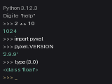
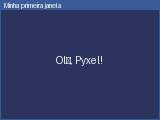

# Aula 1: Ambiente, REPL e primeiro programa

Hoje preparamos o ambiente e escrevemos o primeiro programa. Ao final você
deve conseguir rodar Python no terminal, instalar o Pyxel e abrir uma janela
gráfica.

## O que é o Pyxel

Pyxel é uma biblioteca de jogos retrô para Python. Ela impõe limites de
propósito: tela pequena, 16 cores, 4 canais de som. Isso deixa o foco no que
interessa para quem está começando: lógica de programação.

## Instalação

Você precisa de Python 3.11 ou mais novo. Confira no terminal:

```bash
python3 --version
```

Crie um ambiente virtual para o curso e instale o Pyxel nele:

```bash
python3 -m venv .venv
source .venv/bin/activate      # no Windows: .venv\Scripts\activate
pip install pyxel
pyxel
```

Se `pyxel` imprimir uma linha como `Pyxel 2.9.9, a retro game engine for Python`,
está tudo certo. Outra forma de conferir a versão é
`python -c "import pyxel; print(pyxel.VERSION)"`. Se der
erro, guarde a mensagem inteira e traga para o atendimento de quarta-feira.

| Sistema | Como abrir o terminal                  | Comando do Python |
| :------ | :------------------------------------- | :---------------- |
| Windows | Menu Iniciar, "Terminal"               | `py` ou `python`  |
| Linux   | `Ctrl+Alt+T` na maioria das distros    | `python3`         |
| macOS   | Spotlight, "Terminal"                  | `python3`         |

## O REPL

REPL quer dizer *read, eval, print, loop*: o Python lê o que você digita,
calcula, mostra o resultado e espera de novo. Para entrar, digite `python3`
sem argumentos.



Cada linha que começa com `>>>` foi digitada por você. A linha seguinte é a
resposta. Experimente:

```python
>>> 2 + 3
5
>>> 2 ** 10
1024
>>> 17 // 5
3
>>> "ola " * 3
'ola ola ola '
>>> import pyxel
>>> pyxel.VERSION
```

O REPL é a melhor ferramenta para tirar uma dúvida pequena: "o que acontece se
eu fizer isto?". Para sair, use `exit()` ou `Ctrl+D`.

## Do REPL ao programa

O REPL esquece tudo quando você sai. Para guardar o que escreveu, salve em um
arquivo com extensão `.py` e rode com `python3 arquivo.py`. Um programa é
executado de cima para baixo, uma instrução por vez.

## O primeiro programa com Pyxel

```python
import pyxel

pyxel.init(160, 120, title="Minha primeira janela")


def update():
    pass


def draw():
    pyxel.cls(1)
    pyxel.text(40, 56, "Ola, Pyxel!", 7)


pyxel.run(update, draw)
```



Linha por linha:

1. `import pyxel` traz a biblioteca.
2. `pyxel.init(160, 120, ...)` cria uma janela de 160 por 120 pixels.
3. `update` e `draw` são **funções**. O Pyxel chama as duas a cada quadro,
   trinta vezes por segundo. A próxima seção mostra a receita mínima para
   escrever uma.
4. `pyxel.cls(1)` limpa a tela com a cor de índice 1.
5. `pyxel.text(x, y, texto, cor)` escreve um texto na posição dada.
6. `pyxel.run(update, draw)` começa o jogo e só termina quando a janela fecha.

A tecla `Esc` fecha a janela. O arquivo
[janela-minima.py](janela-minima.py) tem este programa comentado.

## Funções: a receita mínima

Nos primeiros laboratórios você vai **completar funções que já vêm prontas pela
metade**. Para isso basta uma receita:

```python
def dobro(n):
    return n * 2


def titulo():
    return "Minha primeira janela"
```

- `def nome(parametros):` abre a função. Os parâmetros são os valores que ela
  recebe, e podem não existir (`titulo()`).
- O corpo fica indentado, com quatro espaços.
- `return valor` entrega o resultado para quem chamou: `dobro(21)` vale `42`.
- Um número vai sem aspas (`return 160`) e um texto vai com aspas
  (`return "oi"`).

Na semana 5 voltamos às funções com calma: parâmetros, escopo e o ciclo
`update`/`draw`.

## Erros comuns

- `ModuleNotFoundError: No module named 'pyxel'`: o ambiente virtual não está
  ativado, ou o `pip install` rodou em outro Python.
- `IndentationError`: o Python usa a indentação para agrupar blocos. Use
  sempre quatro espaços.
- A janela abre e fecha na hora: faltou `pyxel.run`.

## Exercícios

1. No REPL, calcule quantos segundos tem um dia.
2. No REPL, descubra o tipo de `3`, `3.0` e `"3"` com `type(...)`.
3. Mude o título da janela e a cor do fundo do programa acima.
4. Troque a largura da janela para 200. O texto `Ola, Pyxel!` tem 11
   caracteres de 4 pixels cada. O `x` que o centraliza continua sendo 40? Qual
   `x` o centraliza?
5. Rode `pyxel` no terminal e anote a versão. Você vai precisar dela no laboratório.
6. Escreva uma função `soma(a, b)` que devolve a soma e teste no REPL.

Continue no Laboratório 1: o repositório `lab01-janela` pede funções que
devolvem a largura, a altura, o título e a taxa de quadros da janela.
