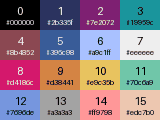

# Aula 2: Variáveis, tipos e expressões

## Variáveis

Uma variável é um nome ligado a um valor. A atribuição usa `=`, que aqui **não**
significa igualdade matemática:

```python
largura = 160
altura = 120
titulo = "Meu jogo"
velocidade = 1.5
vivo = True
```

Regras para os nomes: começam com letra ou `_`, contêm letras, dígitos e `_`,
e não podem ser palavras reservadas como `for` ou `if`. Maiúsculas e
minúsculas diferem: `x` e `X` são variáveis distintas. Prefira nomes que
dizem o que a variável guarda: `velocidade` e não `v`.

Uma variável pode ser reatribuída, usando o valor antigo:

```python
x = 10
x = x + 5  # agora x vale 15
x += 5  # forma curta, x vale 20
```

## Tipos

| Tipo    | Exemplo           | Usamos para                    | Muda no lugar? |
| :------ | :---------------- | :----------------------------- | :------------- |
| `int`   | `3`, `-7`, `0`    | posições, contagens            | não            |
| `float` | `3.5`, `0.25`     | velocidades, ângulos           | não            |
| `str`   | `"oi"`, `'Pyxel'` | textos na tela                 | não            |
| `bool`  | `True`, `False`   | respostas de comparações       | não            |

`type(valor)` mostra o tipo. Converta com `int("3")`, `float(2)` e `str(10)`.
Strings são imutáveis: `texto[0] = "X"` dá erro, é preciso criar outra string.

## Operadores

| Operador | Significado       | Exemplo   | Resultado |
| :------- | :---------------- | :-------- | :-------- |
| `+`      | soma              | `7 + 2`   | `9`       |
| `-`      | subtração         | `7 - 2`   | `5`       |
| `*`      | multiplicação     | `7 * 2`   | `14`      |
| `/`      | divisão real      | `7 / 2`   | `3.5`     |
| `//`     | divisão inteira   | `7 // 2`  | `3`       |
| `%`      | resto             | `7 % 2`   | `1`       |
| `**`     | potência          | `7 ** 2`  | `49`      |

A precedência é a da matemática: `**` primeiro, depois `*`, `/`, `//` e `%`, por
fim `+` e `-`. Use parênteses sempre que houver dúvida.

O resto (`%`) aparece muito em jogos: `quadro % 30 == 0` é verdadeiro uma vez
por segundo.

## A tela é um plano de coordenadas

A tela tem origem `(0, 0)` no **canto superior esquerdo**. O eixo `x` cresce
para a direita e o eixo `y` cresce **para baixo**, ao contrário do que você viu
na aula de matemática. Em uma tela de 160 por 120, o último pixel é `(159, 119)`.

O Pyxel guarda o tamanho da tela em `pyxel.width` e `pyxel.height`, depois de
`pyxel.init`. Prefira esses nomes aos números soltos: se você mudar o tamanho
da janela, o resto do programa acompanha.

Para centralizar um retângulo, calcule o canto superior esquerdo:

```python
w = 40
h = 20
x = (pyxel.width - w) // 2  # 60, em uma tela de 160
y = (pyxel.height - h) // 2  # 50, em uma tela de 120
pyxel.rect(x, y, w, h, 5)
```

Comandos de desenho que usamos hoje:

| Função                         | Desenha                       |
| :----------------------------- | :---------------------------- |
| `pyxel.pset(x, y, cor)`        | um pixel                      |
| `pyxel.line(x1, y1, x2, y2, c)`| uma linha                     |
| `pyxel.rect(x, y, w, h, cor)`  | retângulo preenchido          |
| `pyxel.rectb(x, y, w, h, cor)` | só a borda do retângulo       |
| `pyxel.circ(x, y, r, cor)`     | círculo preenchido            |
| `pyxel.text(x, y, texto, cor)` | texto                         |

## Cores

O Pyxel tem 16 cores, numeradas de 0 a 15.



Algumas que você vai usar muito: `0` preto, `7` branco, `8` vermelho (na
paleta, um rosa-avermelhado), `10` amarelo, `11` verde claro (o `3` é um verde-azulado escuro). Os programas
[coordenadas.py](coordenadas.py) e [cores.py](cores.py) mostram tudo isto.

## f-strings

Para colocar valores em um texto, use uma f-string:

```python
pyxel.text(4, 4, f"x={x} y={y}", 7)
```

## Exercícios

1. Quanto vale `17 // 5`? E `17 % 5`? E `17 / 5`?
2. Dado `largura = 160`, qual é a coordenada `x` do pixel do meio?
3. Desenhe um retângulo de 30 por 30 no canto inferior direito da tela de
   160 por 120.
4. Escreva o `x` de um texto de 11 caracteres para centralizá-lo em
   `pyxel.width`. Cada caractere do Pyxel tem 4 pixels de largura.
5. Qual é o índice do verde claro? E do verde-azulado escuro? Qual é o tipo de `10 / 2`?
