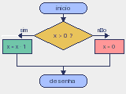

# Aula 3: Condicionais

Até agora nossos programas faziam sempre a mesma coisa. Com condicionais, o
programa decide o que fazer a partir do estado do jogo.

## if, elif e else

```python
if x < 0:
    x = 0
elif x > 150:
    x = 150
else:
    pyxel.text(4, 4, "dentro da tela", 7)
```

Só um dos blocos roda: o primeiro cuja condição for verdadeira. O `else` roda
quando nenhuma das anteriores foi. O `elif` e o `else` são opcionais.



## Comparações

| Operador | Significado       | Exemplo (`x = 5`) | Resultado |
| :------- | :---------------- | :---------------- | :-------- |
| `==`     | igual             | `x == 5`          | `True`    |
| `!=`     | diferente         | `x != 5`          | `False`   |
| `<`      | menor             | `x < 5`           | `False`   |
| `<=`     | menor ou igual    | `x <= 5`          | `True`    |
| `>`      | maior             | `x > 3`           | `True`    |
| `>=`     | maior ou igual    | `x >= 6`          | `False`   |

Cuidado: `=` atribui e `==` compara. `if x = 5:` é um erro de sintaxe.

## Operadores lógicos

Combinam condições:

| A     | B     | `A and B` | `A or B` | `not A` |
| :---- | :---- | :-------- | :------- | :------ |
| True  | True  | True      | True     | False   |
| True  | False | False     | True     | False   |
| False | True  | False     | True     | True    |
| False | False | False     | False    | True    |

Exemplo: o personagem está dentro da tela quando as duas condições valem.

```python
if x >= 0 and x <= 150:
    ...
```

Python aceita a forma encadeada `0 <= x <= 150`. Prefira a que for mais fácil
de ler para você.

## O teclado

O Pyxel tem duas funções para ler teclas:

- `pyxel.btn(tecla)` é verdadeira **enquanto** a tecla estiver apertada.
- `pyxel.btnp(tecla)` é verdadeira só **no quadro** em que a tecla foi apertada.

Use `btn` para andar e `btnp` para ações de uma vez só, como pular ou atirar.
As teclas são constantes como `pyxel.KEY_LEFT`, `pyxel.KEY_SPACE` e
`pyxel.KEY_Q`. O exemplo [teclado.py](teclado.py) mostra qual tecla de direção
está pressionada.

## Mover um quadrado sem sair da tela

```python
if pyxel.btn(pyxel.KEY_LEFT):
    x = x - 2
if pyxel.btn(pyxel.KEY_RIGHT):
    x = x + 2

if x < 0:
    x = 0
if x > 160 - 10:
    x = 160 - 10
```

Note os dois `if` seguidos, e não `elif`: se as duas teclas estiverem
apertadas, o quadrado fica parado. O limite direito é `160 - 10` porque `x` é o
canto esquerdo do quadrado, e ele tem 10 de largura. Veja o programa completo em
[mover-quadrado.py](mover-quadrado.py).

## Teste de mesa

Para entender o código, simule-o no papel. Com `x = 155` e a tecla direita
apertada: `x` vira 157; `157 > 150`, então `x` vira 150. Faça isso com
valores nos limites sempre que escrever uma condição.

## Exercícios

1. Escreva um `if/elif/else` que escolhe a cor do quadrado: vermelho se `x < 50`,
   verde se `x < 100` e azul no resto.
2. Qual é o resultado de `not (3 > 2 and 1 > 5)`?
3. Reescreva `if a: if b: ...` com um único `if` e `and`.
4. Faça o quadrado também andar nas diagonais sem ficar mais rápido que na
   horizontal. Dica: pense no que acontece com duas teclas apertadas.
5. Troque `btn` por `btnp` no programa de mover o quadrado. O que muda e por
   quê?
