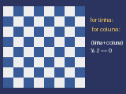

# Aula 4: Laços

Um laço repete um bloco de código. É a ferramenta para desenhar dezenas de
objetos sem escrever dezenas de linhas.

## for e range

```python
for i in range(5):
    print(i)  # 0, 1, 2, 3, 4
```

`range` tem três formas:

| Chamada               | Valores gerados          | Quantidade |
| :-------------------- | :----------------------- | :--------- |
| `range(5)`            | 0, 1, 2, 3, 4            | 5          |
| `range(2, 6)`         | 2, 3, 4, 5               | 4          |
| `range(0, 10, 3)`     | 0, 3, 6, 9               | 4          |
| `range(5, 0, -1)`     | 5, 4, 3, 2, 1            | 5          |

O valor final **nunca** entra. Uma linha de pontos na tela:

```python
for i in range(1, 15):
    pyxel.pset(i * 10, 20, 9)
```

## while

`while` repete enquanto a condição for verdadeira. Use quando você não sabe
quantas voltas serão necessárias:

```python
raio = 1.0
while raio < 56:
    pyxel.circ(80 + raio, 60, 1, 8)
    raio = raio + 0.25
```

Se a variável da condição nunca mudar, o laço nunca termina e o programa
trava. Em um jogo, **nunca** escreva um `while True` dentro de `update`: o
próprio Pyxel já é o laço principal. O exemplo [espiral.py](espiral.py) usa
`while` para desenhar uma espiral.

## break e continue

- `break` sai do laço imediatamente.
- `continue` pula o resto da volta atual e vai para a próxima.

```python
for i in range(10):
    if i % 2 == 0:
        continue  # pula os pares
    if i > 7:
        break  # para depois do 7
    print(i)  # 1, 3, 5, 7
```

## Laços aninhados

Um laço dentro de outro percorre uma grade: o externo escolhe a linha, o
interno escolhe a coluna.

```python
for linha in range(8):
    for coluna in range(8):
        x = coluna * 13
        y = linha * 13
        pyxel.rect(x, y, 13, 13, 7)
```

O corpo interno roda 8 vezes 8, ou seja, 64 vezes. Em geral, `n` voltas por `m`
voltas dão `n * m` execuções.

## Padrão xadrez



A cor de cada casa depende da paridade da soma da linha com a coluna:

```python
for linha in range(8):
    for coluna in range(8):
        if (linha + coluna) % 2 == 0:
            cor = 7
        else:
            cor = 5
        pyxel.rect(coluna * 13, linha * 13, 13, 13, cor)
```

Outros padrões usam a mesma ideia com outra fórmula: listras horizontais
dependem só de `linha % 2`, listras diagonais de `(linha + coluna) % 3`. O
programa [grade.py](grade.py) desenha uma grade de pontos com listras
diagonais.

## Armadilhas

- Esquecer que `range(n)` começa em 0 e termina em `n - 1`.
- Usar o mesmo nome de variável nos dois laços aninhados.
- Alterar a variável do `for` dentro do corpo e esperar que mude a próxima
  volta: o `for` ignora isso.

## Exercícios

1. Quantos valores `range(2, 20, 3)` produz? Liste-os.
2. Desenhe listras verticais alternando branco e cinza.
3. Quantas vezes o corpo interno roda em `for a in range(3): for b in range(4)`?
4. Reescreva a espiral com `for` em vez de `while`. Qual versão ficou mais
   natural?
5. Desenhe uma escada: na linha `i`, `i` quadrados lado a lado.
