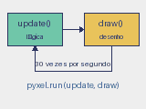

# Aula 5 (reposição): Funções

Você já usou funções sem saber como são feitas: `print`, `range`, `pyxel.rect`.
Na aula 1 você viu a receita mínima de `def` e `return`. Hoje aprofundamos:
parâmetros, valores padrão, escopo e o ciclo `update`/`draw`.

## Definindo e chamando

```python
def dobra(n):
    return n * 2


resultado = dobra(21)    # 42
```

- `def` abre a definição; o nome vem em seguida.
- Os **parâmetros** ficam entre parênteses. Os valores passados na chamada são
  os **argumentos**.
- O corpo é indentado.
- `return` encerra a função e devolve um valor.

Definir uma função não executa nada. O corpo só roda quando alguém chama.

## return versus print

`print` mostra algo na tela do terminal e devolve `None`. `return` entrega um
valor para quem chamou, que pode guardá-lo ou usá-lo em outra conta.

```python
def soma_print(a, b):
    print(a + b)

def soma_return(a, b):
    return a + b

x = soma_print(1, 2)    # imprime 3, mas x vale None
y = soma_return(1, 2)   # y vale 3
```

Uma função sem `return` devolve `None`. Funções que **calculam** devem devolver;
funções que **desenham** costumam não devolver nada.

## Argumentos padrão

```python
def desenha_bola(x, y, cor=10):
    pyxel.circ(x, y, 6, cor)

desenha_bola(40, 30)         # cor 10
desenha_bola(40, 30, 8)      # cor 8
desenha_bola(40, 30, cor=8)  # nomeado, mais claro
```

## Escopo

Variáveis criadas dentro da função são **locais**: só existem durante a
chamada.

```python
def f():
    temp = 5

f()
print(temp)     # NameError: temp não existe aqui
```

Variáveis globais podem ser lidas dentro da função. Para **atribuir** a uma
global, é preciso declarar `global x`. Prefira receber valores por parâmetros e
devolver o resultado: o código fica mais fácil de testar.

## O ciclo do Pyxel

Agora dá para entender `pyxel.run(update, draw)`: ele recebe duas funções e
as chama, em ordem, a cada quadro.



| Função     | Responsabilidade                     | Exemplos                             |
| :--------- | :----------------------------------- | :----------------------------------- |
| `update()` | mudar o estado do jogo               | ler teclas, mover, contar pontos     |
| `draw()`   | mostrar o estado na tela             | `cls`, `rect`, `circ`, `text`        |

Regra de ouro: **não** altere o estado dentro de `draw`, e **não** desenhe
dentro de `update`. Se `draw` mudar a posição, o jogo passa a depender de
quantas vezes a tela é redesenhada.

## Exemplo: a bola quicando

```python
def move(posicao, velocidade):
    return posicao + velocidade


def quica(posicao, velocidade, limite_min, limite_max):
    if posicao < limite_min or posicao > limite_max:
        return -velocidade
    return velocidade
```

Duas funções pequenas, cada uma com um trabalho, devolvendo um único número e
sem efeito colateral. O `update` as chama uma vez para cada eixo. Veja [bola.py](bola.py). Uma versão
que roda no navegador está em [bola-jogavel.html](bola-jogavel.html).

Por enquanto, cada função devolve um único valor. Devolver vários valores de
uma vez exige tuplas, que ficam para a semana 8.

## Bom estilo

- Uma função, um trabalho. Se o nome precisa de "e" (`move_e_desenha`), divida.
- Nomes de verbo: `move`, `quica`, `desenha_bola`.
- Escreva uma docstring de uma linha entre aspas triplas.

## Exercícios

1. Escreva `limita(valor, minimo, maximo)` que mantém `valor` no intervalo.
   Use-a para impedir o quadrado de sair da tela.
2. O que imprime `print(soma_print(1, 2))`?
3. Por que `temp` não existe fora de `f` no exemplo de escopo?
4. Escreva `distancia(x1, y1, x2, y2)` usando `math.sqrt`.
5. Faça a bola acelerar um pouco a cada quique, sem criar variáveis globais
   novas além de `x`, `y`, `vx` e `vy`.

O gabarito do laboratório será liberado depois do laboratório.
