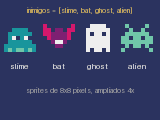

# Aula 6: Listas

Um jogo tem várias gotas, estrelas, inimigos. Em vez de uma variável para cada,
usamos uma **lista**.

## Criando e acessando

```python
inimigos = ["slime", "morcego", "fantasma"]
print(inimigos[0])  # slime
print(inimigos[-1])  # fantasma, o último
print(len(inimigos))  # 3
```

Os índices começam em 0. Índices negativos contam do fim: `-1` é o último, `-2`
o penúltimo. Um índice fora do intervalo causa `IndexError`.



## Alterando

Ao contrário de strings, listas são mutáveis:

```python
inimigos[0] = "alien"
inimigos.append("slime")  # acrescenta ao fim
inimigos.insert(0, "morcego")  # insere no começo
ultimo = inimigos.pop()  # remove e devolve o último
inimigos.remove("alien")  # remove o primeiro "alien"
```

| Método            | O que faz                                  | Resultado em `[1, 2]` |
| :---------------- | :----------------------------------------- | :-------------------- |
| `append(3)`       | acrescenta um elemento                     | `[1, 2, 3]`           |
| `extend([3, 4])`  | acrescenta os elementos de outra lista     | `[1, 2, 3, 4]`        |
| `append([3, 4])`  | acrescenta a lista inteira como um item    | `[1, 2, [3, 4]]`      |
| `pop()`           | remove o último                            | `[1]`                 |

## Fatiamento

`lista[inicio:fim]` devolve uma cópia parcial, com o fim excluído:

```python
n = [10, 20, 30, 40, 50]
n[1:4]  # [20, 30, 40]
n[:2]  # [10, 20]
n[3:]  # [40, 50]
n[::-1]  # [50, 40, 30, 20, 10]
```

## Laços sobre listas

```python
for gota in gotas:
    gota[1] += 3  # cada gota é [x, y]
```

Para ter o índice junto: `for i, gota in enumerate(gotas)`. Para desempacotar
os pares: `for x, y in gotas`.

## Compreensão de listas

Uma **compreensão de lista** constrói uma lista nova a partir de outra, em uma
linha só. A forma geral é `[expressão for item in lista if condição]`, e o
`if` é opcional:

```python
n = [1, 2, 3, 4, 5, 6]
dobros = [v * 2 for v in n]  # [2, 4, 6, 8, 10, 12]
pares = [v for v in n if v % 2 == 0]  # [2, 4, 6]
```

É o mesmo que um `for` com `append`:

```python
pares = []
for v in n:
    if v % 2 == 0:
        pares.append(v)
```

Use a compreensão quando ela couber em uma linha legível. Ela é a forma curta
de filtrar uma lista sem remover itens durante o laço, que é o assunto da
próxima seção.

## Remover durante o laço é perigoso

```python
for g in gotas:
    if g[1] > 120:
        gotas.remove(g)  # ERRADO: pula o próximo elemento
```

Ao remover, os elementos seguintes mudam de índice, e o `for` segue em frente
sem perceber. Há duas saídas seguras, a primeira usando uma compreensão:

```python
gotas = [g for g in gotas if g[1] <= 120]  # reconstrói a lista
for g in list(gotas):  # percorre uma cópia
    ...
```

Em `update`, escreva `gotas[:] = [...]` para alterar a lista no lugar, sem
precisar de `global`.

## Exemplos

- [chuva.py](chuva.py): uma gota nova a cada três quadros, e as que saem da
  tela são descartadas.
- [estrelas.py](estrelas.py): cada estrela é `[x, y, velocidade]` e volta ao
  topo ao sair.

## Exercícios

1. Qual o valor de `[5, 6, 7, 8][-2]`?
2. O que `a[1:4]` devolve para `a = [0, 1, 2, 3, 4, 5]`?
3. Qual a diferença entre `append` e `extend`?
4. Na chuva, faça gotas de velocidades diferentes. Onde guardar a velocidade?
5. Limite a chuva a, no máximo, 50 gotas.
6. Escreva uma compreensão que devolve só as gotas com `x` menor que 80.
