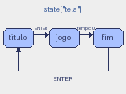

# Aula 8: Dicionários e tuplas

## Dicionários

Um dicionário liga **chaves** a **valores**:

```python
player = {"x": 80, "y": 100, "vidas": 3, "nome": "Ada"}
print(player["vidas"])      # 3
player["vidas"] -= 1
player["escudo"] = True     # cria uma chave nova
```

Acessar uma chave que não existe com `[]` causa `KeyError`. Para um valor
padrão, use `get`:

```python
player.get("bomba")         # None
player.get("bomba", 0)      # 0
```

Operações comuns:

```python
"x" in player               # True
for chave, valor in player.items():
    print(chave, valor)
del player["escudo"]
```

As chaves costumam ser strings ou números. Os valores podem ser qualquer coisa,
inclusive listas e outros dicionários.

## Tuplas

Uma tupla é uma sequência **imutável**:

```python
posicao = (80, 100)
x, y = posicao              # desempacotamento
posicao[0] = 5              # TypeError
```

Para mudar uma posição, crie outra tupla. Use tuplas para valores que
formam um todo e não mudam no lugar: coordenadas, cores RGB, tamanhos.

| Característica         | `list`            | `tuple`         | `dict`                  |
| :--------------------- | :---------------- | :-------------- | :---------------------- |
| Sintaxe                | `[1, 2]`          | `(1, 2)`        | `{"a": 1}`              |
| Acesso                 | por índice        | por índice      | por chave               |
| Mutável                | sim               | **não**         | sim                     |
| Pode ser chave de dict | não               | sim             | não                     |
| Uso típico             | muitos itens      | valor composto  | registro com campos     |

Tuplas como chaves de dicionário são úteis em grades:

```python
mapa = {(0, 0): "parede", (1, 0): "chão"}
```

## O estado do jogo em um dicionário

Todo o estado de um jogo cabe em um dicionário:

```python
state = {"tela": "titulo", "pontos": 0, "tempo": 150}
```



O campo `tela` diz qual das três telas está ativa. Cada tela tem a sua função
de `update` e de `draw`, e o `update` principal só despacha:

```python
def update():
    if state["tela"] == "titulo":
        update_titulo()
    elif state["tela"] == "jogo":
        update_jogo()
    else:
        update_fim()
```

As transições são mudanças em `state["tela"]`: ENTER no título vai para o
jogo; o tempo zerando vai para o fim; ENTER no fim volta ao título. O programa
completo está em [estados.py](estados.py).

Vantagens de manter o estado em um único lugar:

- Reiniciar o jogo é redefinir o dicionário.
- Salvar o jogo é gravar o dicionário (veremos na aula 13).
- As funções de `draw` só leem o dicionário.

## Que valores cabem em um estado

Números, strings, booleanos, listas, tuplas e outros dicionários. Funções e
objetos do Pyxel também cabem, mas dificultam salvar o estado em disco.

## Exercícios

1. Dado `d = {"a": 1}`, o que fazem `d["b"]` e `d.get("b")`?
2. Por que `(1, 2)` pode ser chave de dicionário e `[1, 2]` não?
3. Acrescente uma tela de pausa ao programa de estados. Quais transições ela
   precisa?
4. Guarde as cores do jogo em um dicionário `CORES = {"fundo": 1, "texto": 7}`.
5. Escreva uma função `novo_estado()` que devolve o dicionário inicial.
