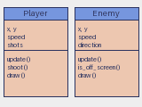

# Aula 9: Classes

Até aqui, cada inimigo era uma lista ou um dicionário e as funções que mexiam
neles viviam soltas. Uma **classe** junta os dados e o comportamento.

## Classe e objeto

Uma classe é a receita; um objeto é o que sai dela. Cada objeto tem os seus
próprios dados.

```python
class Enemy:
    def __init__(self, x, y, speed):
        self.x = x
        self.y = y
        self.speed = speed

    def update(self):
        self.y += self.speed

    def draw(self):
        pyxel.circ(self.x, self.y, 5, 8)


e1 = Enemy(20, 0, 1.0)
e2 = Enemy(90, 0, 2.5)
e1.update()
```

- `__init__` é chamado ao criar o objeto e prepara os **atributos**.
- `self` é o próprio objeto. O Python o passa sozinho: você escreve
  `e1.update()` mas a definição é `def update(self)`.
- Funções dentro de uma classe se chamam **métodos**.



## Comparando dicionário e classe

| Aspecto            | Dicionário                  | Classe                           |
| :----------------- | :-------------------------- | :------------------------------- |
| Criar              | `{"x": 1, "y": 2}`          | `Enemy(1, 2, 1.0)`               |
| Ler um campo       | `e["x"]`                    | `e.x`                            |
| Comportamento      | funções soltas              | métodos na própria classe        |
| Nome de campo errado | `KeyError: 'xx'`          | `AttributeError: ... 'xx'`       |

## O jogador

```python
class Player:
    def __init__(self, x, y):
        self.x = x
        self.y = y
        self.speed = 2
        self.shots = []

    def update(self):
        if pyxel.btn(pyxel.KEY_LEFT):
            self.x -= self.speed
        if pyxel.btnp(pyxel.KEY_SPACE):
            self.shoot()

    def shoot(self):
        self.shots.append([self.x, self.y - 6])
```

Um método pode chamar outro com `self.shoot()`. O programa completo está em
[nave.py](nave.py).

## Vários objetos

Objetos cabem em listas, e as listas se percorrem com `for`:

```python
enemies = []
enemies.append(Enemy(10, -4, 1.0))
for enemy in enemies:
    enemy.update()
enemies[:] = [e for e in enemies if not e.is_off_screen()]
```

Veja [inimigos.py](inimigos.py): um inimigo novo a cada 20 quadros, cada um
com a sua velocidade.

## Herança, de leve

Quando dois tipos compartilham quase tudo, um pode **herdar** do outro:

```python
class Boss(Enemy):
    def __init__(self, x, y):
        super().__init__(x, y, speed=0.3)
        self.life = 20
```

Use herança quando a relação "é um" fizer sentido (um `Boss` é um `Enemy`).
Para "tem um" (a nave tem tiros), use atributos. Em projetos pequenos,
prefira composição e deixe a herança para casos claros.

## Convenções

- Nome de classe em `CamelCase`, métodos em `snake_case`.
- Atributos sempre definidos no `__init__`.
- Um método que só responde uma pergunta (`is_off_screen`) devolve um bool e
  não altera nada.

## Exercícios

1. O que acontece se esquecer o `self` na definição de `update`?
2. Acrescente `life` ao `Enemy` e faça-o ficar vermelho quando restar 1.
3. Crie a classe `Shot` e troque a lista `[x, y]` dos tiros por objetos.
4. Faça `Player.update` impedir que a nave saia da tela.
5. Quando é melhor usar um dicionário em vez de uma classe?
