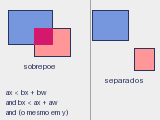

# Aula 10: Colisão e geometria

Para o tiro acertar o inimigo, o jogo precisa saber se dois objetos se
tocam. Hoje vemos os testes mais simples.

## Ponto dentro de um retângulo

Um ponto `(px, py)` está dentro do retângulo `(x, y, w, h)` quando os dois eixos
estão dentro dos limites:

```python
def point_in_rect(px, py, x, y, w, h):
    return x <= px < x + w and y <= py < y + h
```

## AABB: retângulo contra retângulo

AABB quer dizer *axis-aligned bounding box*: retângulo cujos lados são
paralelos aos eixos. Dois deles **se sobrepõem** quando seus intervalos se
sobrepõem **nos dois eixos**.



```python
def overlaps(a, b):
    ax, ay, aw, ah = a
    bx, by, bw, bh = b
    return ax < bx + bw and bx < ax + aw and ay < by + bh and by < ay + ah
```

A estratégia mais fácil de acertar é pensar na negação: eles **não** se
sobrepõem se `a` está inteiro à esquerda de `b`, ou inteiro à direita, ou
inteiro acima, ou inteiro abaixo. Basta um dos quatro.

## Casos de teste

Teste a função com casos que exploram as bordas. Use `a = (0, 0, 10, 10)`:

| `b`              | Situação                    | `overlaps(a, b)` |
| :--------------- | :-------------------------- | :--------------- |
| `(5, 5, 10, 10)` | sobreposição parcial        | `True`           |
| `(2, 2, 4, 4)`   | `b` dentro de `a`           | `True`           |
| `(20, 0, 5, 5)`  | separados no eixo x         | `False`          |
| `(0, 20, 5, 5)`  | separados no eixo y         | `False`          |
| `(10, 0, 5, 5)`  | encostados na borda         | `False`          |
| `(9, 9, 5, 5)`   | invadem por 1 pixel         | `True`           |

Retângulos que só se encostam não colidem, porque usamos `<` e não `<=`. É uma
decisão: documente a sua.

Um programa interativo está em [aabb.py](aabb.py): mova o retângulo
verde com as setas.

## Área de sobreposição

A largura da sobreposição é `min(ax + aw, bx + bw) - max(ax, bx)`; a altura é
análoga. Se qualquer uma for negativa ou zero, não há colisão. A área é o
produto das duas.

```python
def overlap_area(a, b):
    ax, ay, aw, ah = a
    bx, by, bw, bh = b
    w = min(ax + aw, bx + bw) - max(ax, bx)
    h = min(ay + ah, by + bh) - max(ay, by)
    return max(w, 0) * max(h, 0)
```

## Círculos

Dois círculos colidem quando a distância entre os centros é no máximo a soma
dos raios. Para evitar a raiz quadrada, compare os quadrados:

```python
dx = a["x"] - b["x"]
dy = a["y"] - b["y"]
colide = dx * dx + dy * dy <= (a["r"] + b["r"]) ** 2
```

Veja [colisao-circulo.py](colisao-circulo.py).

## Qual usar

- Retângulos: nave, blocos, plataformas, quase tudo.
- Círculos: bolas, projéteis redondos, áreas de alcance.
- Em caso de dúvida, comece pelo retângulo, é mais simples de depurar. Desenhe
  `rectb` ao redor do objeto durante o desenvolvimento.

## Exercícios

1. `overlaps((0, 0, 4, 4), (3, 3, 4, 4))`?
2. Qual a área de sobreposição de `(0, 0, 10, 10)` e `(5, 5, 10, 10)`?
3. Escreva a condição para o ponto `(px, py)` estar dentro de `(x, y, w, h)`.
4. Faça os tiros da nave sumirem ao acertar um inimigo.
5. Por que o teste de círculos não precisa de `math.sqrt`?
