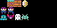

# Aula 11: Sprites e tilemaps

Retângulos e círculos servem para começar, mas jogos de verdade têm
personagens desenhados. Hoje usamos o editor de recursos do Pyxel.

## O editor

```bash
pyxel edit personagem.pyxres
```

Se o arquivo não existir, o editor o cria ao salvar. A janela tem quatro modos:
imagem, tilemap, som e música. Nos modos de imagem e tilemap você desenha com
o mouse, escolhendo cores na paleta.

Um arquivo `.pyxres` guarda tudo junto:

| Recurso   | Quantidade | Tamanho                       |
| :-------- | :--------- | :---------------------------- |
| Imagens   | 3 bancos   | 256 por 256 pixels            |
| Tilemaps  | 8          | 256 por 256 tiles             |
| Sons      | 64         | 32 notas cada                 |
| Músicas   | 8          | 4 canais                      |

O arquivo `.pyxres` é binário (na verdade um zip). Não o edite à mão e
**versione-o** no git junto com o código.

## Sprites

Um sprite é um pedaço do banco de imagens. O desenho abaixo é uma folha de
sprites com tiles de 8 por 8 pixels: chão, tijolo, moeda, o personagem em dois
passos e quatro inimigos.



Para desenhar o sprite na tela, use `blt`:

```python
pyxel.blt(x, y, 0, u, v, 8, 8, 0)
```

| Argumento | Significa                                             |
| :-------- | :---------------------------------------------------- |
| `x, y`    | onde desenhar na tela                                 |
| `0`       | banco de imagens                                      |
| `u, v`    | canto superior esquerdo do sprite no banco            |
| `8, 8`    | largura e altura                                      |
| `0`       | cor transparente (`colkey`)                           |

Largura **negativa** espelha na horizontal, o que evita desenhar dois
sprites, um olhando para cada lado.

Para carregar uma imagem PNG para o banco 0:

```python
pyxel.images[0].load(0, 0, "sprites.png")
```

Para carregar tudo de um `.pyxres`:

```python
pyxel.load("personagem.pyxres")
```

O caminho é relativo à pasta onde o programa **roda**. Para não depender disso,
monte o caminho a partir de `__file__`, como em [plataforma.py](plataforma.py).

## Tilemaps

Um tilemap é uma grade em que cada célula aponta para um tile (8 por 8) no banco
de imagens. Mapas inteiros são desenhados de uma vez:

```python
pyxel.bltm(0, 0, 0, camera_x, 0, 128, 128, 0)
```

Os argumentos são: posição na tela, número do tilemap, canto do trecho do mapa
(em pixels), tamanho do trecho e cor transparente.

Para ler uma célula, use `pget` com coordenadas em **tiles**:

```python
tile = pyxel.tilemaps[0].pget(5, 14)  # devolve (1, 0), por exemplo
```

O resultado é uma tupla `(coluna, linha)` do tile na folha. Assim identificamos
o que existe em cada lugar: `(1, 0)` é chão, `(2, 0)` é tijolo.

## Plataforma

O programa [plataforma.py](plataforma.py) carrega `personagem.pyxres` e
move o personagem com setas e espaço:

1. Calcula o movimento horizontal e só aplica se os quatro cantos da caixa do
   personagem não entrarem em um tile sólido.
2. Soma a gravidade a `vy` a cada quadro, depois tenta aplicar `vy` ao `y`.
3. Quando bate no chão, zera `vy` e marca `on_ground`, o que libera o pulo.
4. A câmera acompanha o personagem, travada nos limites do mapa.
5. Uma moeda sob o personagem some do mapa com `pset` e soma um ponto.

## Dicas

- Organize a folha: chão e blocos em uma linha, personagem em outra.
- Mantenha a cor 0 como fundo transparente dos sprites.
- Crie o mapa em um quadrado de 16 por 16 tiles primeiro.
- Teste cada bloco do mapa: um tile solid errado faz o personagem atravessar
  paredes ou ficar preso.

## Exercícios

1. Qual o tamanho de um tile em pixels?
2. Desenhe um sprite de 8 por 8 de uma moeda e carregue-o com `blt`.
3. Espelhe o personagem quando ele andar para a esquerda.
4. Acrescente um tile de espinho que reinicia o personagem.
5. Alterne os dois quadros de animação do personagem a cada 6 quadros
   (`pyxel.frame_count // 6 % 2`).
