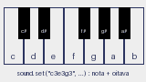

# Aula 12: Som e música

## Como o som funciona no Pyxel

O Pyxel tem **4 canais** de áudio. Cada canal toca um som por vez, mas vários
canais tocam juntos. Os sons ficam em **64 slots** (0 a 63) e as músicas em
**8 slots** (0 a 7); uma música é só uma lista de sons para cada canal.

## Criando um som

```python
pyxel.sounds[0].set("c3e3g3c4", "p", "7", "f", 6)
```

Os cinco argumentos de `Sound.set` são:

| Argumento | Exemplo     | Significado                                          |
| :-------- | :---------- | :--------------------------------------------------- |
| notas     | `"c3e3g3c4"`| nota, acidente opcional e oitava; `r` é pausa        |
| timbres   | `"p"`       | `t` triângulo, `s` quadrada, `p` pulso, `n` ruído   |
| volumes   | `"7"`       | de 0 a 7                                             |
| efeitos   | `"f"`       | `n` nenhum, `s` desliza, `v` vibrato, `f` fade out   |
| velocidade| `6`         | quanto maior, mais lento                             |

Se timbres, volumes ou efeitos forem mais curtos que as notas, eles se repetem
desde o começo. Por isso `"p"` vale para todas as notas.

## Notação das notas



O nome é uma letra de `c` a `b`, seguida por `#` (sustenido) ou `-` (bemol) e
pelo número da oitava. Alguns exemplos:

| Texto  | Nota                     |
| :----- | :----------------------- |
| `c3`   | dó da oitava 3           |
| `f#2`  | fá sustenido da oitava 2 |
| `b-1`  | si bemol da oitava 1     |
| `r`    | pausa                    |

Um dó é `c`, ré `d`, mi `e`, fá `f`, sol `g`, lá `a` e si `b`. O Pyxel
aceita oitavas de 0 a 4.

## Tocando

```python
pyxel.play(0, 0)  # canal 0, som 0
pyxel.play(1, 1)  # canal 1, som 1
pyxel.play(0, 0, loop=True)
pyxel.stop()  # para todos os canais
```

Escolha canais diferentes para sons que podem tocar ao mesmo tempo (um efeito
de moeda não deve cortar a música). O exemplo [som.py](som.py) toca uma moeda
com a barra de espaço e uma batida com X.

## Música

```python
pyxel.sounds[0].set("e3e3g3a3 g3e3d3c3", "s", "6", "nnnf", 20)
pyxel.sounds[1].set("c2r g1r c2r g1r", "t", "5", "n", 20)
pyxel.musics[0].set([0], [1])  # canal 0 toca o som 0, canal 1 toca o 1
pyxel.playm(0, loop=True)
```

Cada lista de `musics[n].set` é a sequência de sons de **um** canal. Para
repetir um trecho, ponha o som várias vezes: `[0, 0, 2, 3]`. O programa
[musica.py](musica.py) liga e desliga uma melodia com o espaço.

## Efeitos de jogo

- Moeda: notas ascendentes e curtas, timbre pulso.
- Pulo: duas notas, a segunda mais aguda, efeito `s`.
- Explosão: ruído `n` com volume alto e fade out.
- Dano: notas descendentes, timbre quadrado (`s`).

Toque o efeito **uma vez** no quadro do evento, usando `btnp` ou o instante da
colisão. Chamar `play` em todo quadro reinicia o som e ele não termina.

## Editor de sons

Também dá para compor no editor (`pyxel edit`) e carregar o resultado com
`pyxel.load`, junto com os sprites. Para programadores, a notação em texto
costuma ser mais rápida de ajustar.

## Exercícios

1. Quantos canais de som o Pyxel tem?
2. Escreva uma sequência de 4 notas que sobe uma oitava.
3. Faça o efeito de pulo e toque-o quando o personagem sai do chão.
4. Componha uma música de 8 notas para o menu e toque-a em loop.
5. Silencie tudo quando o jogador apertar M.
